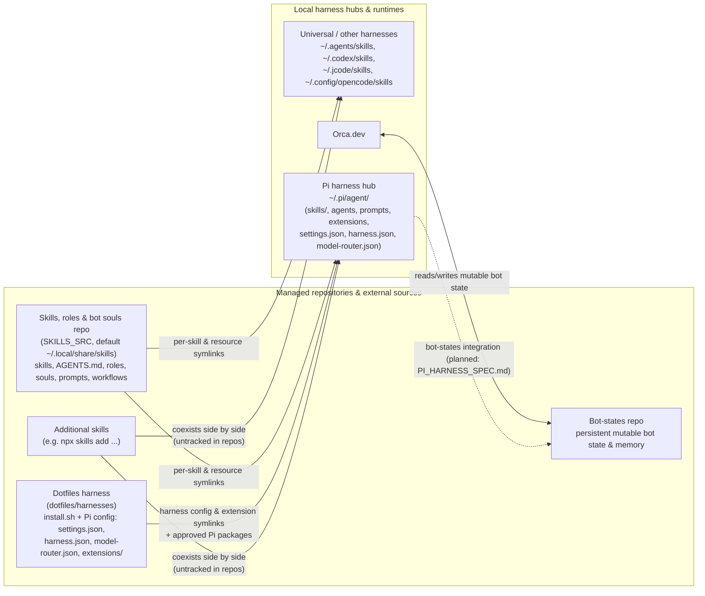

# Coding harnesses

Machine-specific installation and runtime configuration for coding agents. This
directory is the harness layer of a three-repository setup that keeps portable
agent definitions, harness wiring, and mutable runtime state cleanly separated.

## Architecture and separation of concerns

The setup spans three repositories plus any third-party skills installed locally
and the Pi-specific harness configuration:

| Layer | Owns | Does not own |
| --- | --- | --- |
| **Dotfiles harness** (`dotfiles/harnesses`, including `harnesses/pi/`) | Machine-specific installers, discovery symlinks, and harness configuration (for Pi: `settings.json`, `harness.json`, `model-router.json`, owned extensions, schemas, and `packages.lock.json`). | Portable engineering behavior, duplicated skills/roles/souls, third-party skills, or mutable runtime state. |
| **Skills, roles, and bot souls repo** (`SKILLS_SRC`, default `~/.local/share/skills`) | Portable Agent Skills, shared `AGENTS.md`, policies, roles, bot souls/personas, language/domain profiles, prompts, workflow templates, and schemas. | Machine credentials, mutable bot/runtime state, or installation side effects. |
| **Bot-states repo** | Persistent, mutable bot runtime state (memory, operational state, and per-bot data that evolves across runs). | Portable skills/roles/souls or harness installation logic. |
| **Additional / external skills** (e.g. `npx skills add ...`) | Extra third-party or machine-specific skill packages installed directly into a local harness skills hub. | Any files tracked in `dotfiles` or the skills, roles, and bot souls repo. |



Change reusable agent guidance, roles, and bot souls in the skills, roles, and
bot souls repo; change a specific harness or machine integration here; keep
evolving bot runtime state in the bot-states repo (used by Orca.dev; Pi
integration is specified in [`PI_HARNESS_SPEC.md`](PI_HARNESS_SPEC.md) and not
yet implemented). The installer reads the skills checkout from
`~/.local/share/skills` by default (`SKILLS_SRC` overrides this path) and
exposes authored skills through symlinks in the selected harness directory.

## Coexistence of multiple skill sources

The dotfiles harness is explicitly designed so multiple skill sources coexist
side by side without polluting this repository or the skills, roles, and bot
souls repo:

- **Per-skill symlinks inside a real hub directory**: Rather than symlinking the
  entire `skills/` directory, the installers create a real directory at the
  discovery hub (`~/.agents/skills`, `~/.pi/agent/skills`, `~/.codex/skills`,
  `~/.jcode/skills`, or `~/.config/opencode/skills`) and symlink each authored
  skill individually into it.
- **Side-by-side external packages**: Because the hub directory itself is not a
  symlink into a repo, extra skill packages installed via `npx skills add ...`
  (or local machine-only skills) live right alongside the symlinked skills from
  the skills, roles, and bot souls repo without modifying or dirtying any
  managed repository.
- **Safe install and uninstall**: The installers refuse to overwrite existing
  non-symlink paths, and `--uninstall` only removes symlinks whose targets
  belong to `SKILLS_SRC` or `dotfiles/harnesses`, leaving external skills
  untouched.

## Installation

Run from this directory:

```bash
./install.sh --target codex
```

Supported targets are `codex`, `pi`, `jcode`, `opencode`, and `universal`. With
no target, the script prompts on a terminal and chooses `universal` when run
non-interactively. Use `--uninstall` with a target to remove links owned by this
installer. It refuses to replace non-symlink destinations and does not clone or
pull repositories.

For Pi installation, package syncing, verification, and runtime details, see
[`pi/README.md`](pi/README.md). The root installer delegates Pi installation and
uninstallation to [`pi/install.sh`](pi/install.sh).
